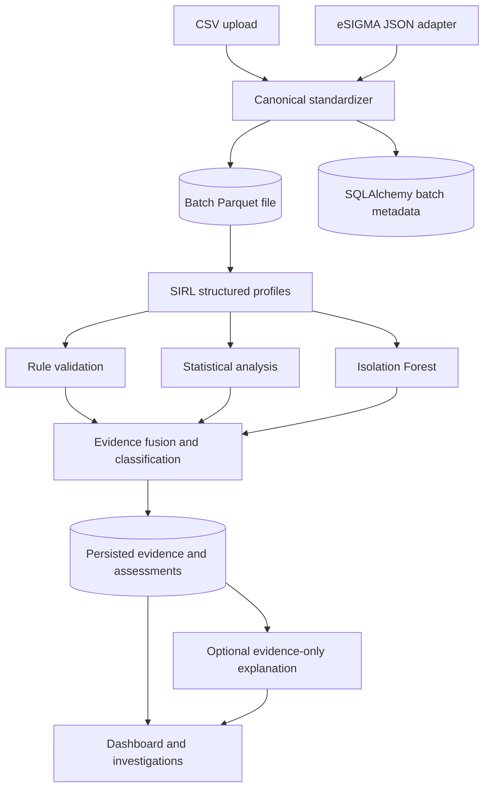
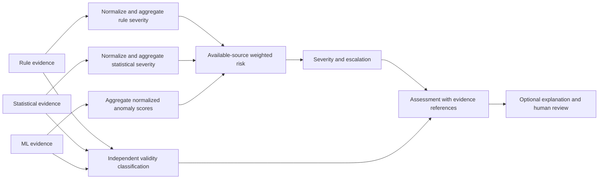

# Survey Data Intelligence

**SIRL · Explainable survey-quality analysis with rules, statistics and Isolation Forest.**

Survey Data Intelligence turns CSV or eSIGMA-format submissions into a persisted data-quality investigation workflow. A Python pipeline normalizes records, stores Parquet batches, builds structured profiles, combines three validation channels, and exposes record-level evidence through a Next.js dashboard. Optional AI explains selected evidence after scoring; it does not assign risk or decide whether a record violates a validity rule.

The bundled PLFS-oriented examples and ground-truth evaluation are **synthetic/demo data**. The implementation is designed for inspecting survey quality and unusual response patterns; an anomaly signal is a reason to investigate, not proof of fabrication.

[Data flow](#data-lineage-and-processing) · [ML methodology](#isolation-forest-methodology) · [Scoring](#evidence-fusion-and-classification) · [Evaluation](#synthetic-ground-truth-evaluation) · [Run locally](#run-locally)

## Data lineage and processing



The [standardizer](backend/app/modules/ingestion/standardizer.py) applies canonical aliases, normalizes names and whitespace, disambiguates duplicate columns, orders columns and applies a common missing-value policy. Numeric-compatible columns use pandas nullable integer or floating types; mixed nonnumeric columns remain strings. The response retains schema version, columns and dtypes so ingestion decisions are inspectable.

The [Parquet store](backend/app/modules/storage/parquet.py) writes one processed dataset per batch. SQLAlchemy stores batch identity, input hashes, stage state, profiles, evidence and investigation records. SQLite is the default database; the durable analytical dataset lives separately in Parquet. Backups must include both.

The [ingestion routes](backend/app/modules/ingestion/router.py) queue the pipeline by default (`auto_pipeline=true`). `auto_pipeline=false` supports ingestion without immediate validation. Content hashes can reuse completed ingestion/pipeline results when enabled. The [orchestrator](backend/app/modules/pipeline/orchestrator.py) records stage progress and outcomes; worker dispatch and startup recovery are implemented in the pipeline module. This is an in-process worker design with a default single concurrent pipeline, not a distributed queue.

The eSIGMA adapter supports a bundled mock path and a configured HTTP source. Real external connectivity requires the appropriate endpoint, credentials and successful health/probe behavior; fixture ingestion does not establish a government-system integration.

## Profiling and validation

SIRL means **Survey Intelligence Retrieval Layer**. It builds reusable dataset, variable, record, enumerator, cluster, district and historical context from completed batches. Its [profiler](backend/app/modules/sirl/profiler.py) uses pandas/NumPy summaries and hierarchy grouping. It is structured analytical context rather than document embeddings or vector retrieval.

Three downstream channels produce separately stored evidence:

| Channel | Implementation | Meaning of its output |
| --- | --- | --- |
| Rules | Allowlisted predicates, optional conditions, cross-field comparisons and reference lookups in the [rule evaluator](backend/app/modules/validation/rules/evaluator.py). | A specific declared constraint was violated, or the rule was skipped with a reason such as a missing field. |
| Statistics | Dataset z-scores, Tukey IQR, enumerator/cluster/district group z-scores and prior-batch mean comparisons in the [statistics engine](backend/app/modules/validation/statistics/engine.py). | A value or aggregate is unusual under the available reference and configured thresholds. |
| ML | Numeric feature selection, reference-population fitting, median imputation and Isolation Forest in the [ML engine](backend/app/modules/validation/ml/engine.py). | Relative isolation under the fitted model; numerical score and model provenance accompany flagged records. |

Rule evaluation dispatches to defined operators rather than executing arbitrary expressions. Null-handling, conditional rules and missing-column skips are explicit. Statistical detectors use observation-count and variance guards; historical comparison uses prior batches rather than treating the current batch as its own history.

Additional intelligence modules support relationship, enumerator, geographic, historical, temporal and pattern investigations. Their evidence and hierarchy context should be read with the underlying rule/statistical/ML records rather than interpreted as extra independent probabilities.

## Isolation Forest methodology

The model selects numeric survey measures while excluding identifiers and categoricals. Where structured variable profiles are available, they constrain the usable numeric feature set.

1. Load eligible historical batches and combine their reference columns.
2. Use the historical reference when it contains enough training records; otherwise fit on the current batch if it is large enough.
3. Learn medians from the selected training/reference population and apply those same medians to current records. Columns without a usable training median are excluded.
4. Fit Isolation Forest, then retain raw scores, normalized scores, prediction labels, feature names, training source and model configuration.

Current defaults in [configuration](backend/app/config.py) are **100 trees**, `contamination="auto"`, `random_state=42`, a minimum of **32 training rows**, and at least **two usable features**. Insufficient data/features produce explicit stage results rather than an invented model score. Current-batch fitting measures relative isolation in that batch; it is not held-out validation.

The [model implementation](backend/app/modules/validation/ml/model.py) transforms sklearn scores as follows:

```text
raw = -IsolationForest.score_samples(X)
lo, hi = 1st and 99th percentiles of raw scores on training data
anomaly_score = clip(100 * (raw - lo) / (hi - lo), 0, 100)
```

A degenerate training-score span maps to zeros. These are **training-percentile-scaled anomaly scores**, not empirical percentile ranks or probabilities that a response is wrong. sklearn prediction labels determine which records become ML detections; a displayed score of 91 does not mean 91% certainty. ML-only severity thresholds are 60 for MEDIUM and 80 for HIGH, separate from fused severity.

## Evidence fusion and classification

The current method is `fusion-v1-prototype`. It combines **rules, statistics and ML only**. Historical/reference context informs upstream analysis and confidence metadata; it is not a fourth weighted channel. AI is not a scoring channel.



### Risk and evidence confidence

| Source | Default weight |
| --- | ---: |
| Rules | 0.40 |
| Statistics | 0.35 |
| ML | 0.25 |

Weights are renormalized over **available engine runs**, not just sources that flagged a particular record:

```text
risk = sum(source_score[s] * weight[s] / sum(available_weights))
```

A completed available source can contribute zero evidence for a record. Within each source, multiple detections aggregate as `min(100, strongest + 0.20 * sum(remaining))`. Rule severities map to 0/25/50/80/100; statistical severities map to 0/30/60/90/100. ML scores are already on the 0–100 scale. The [scorer](backend/app/modules/validation/fusion/scoring.py) clips values and rounds reported risk to two decimal places.

| Fused risk | Severity before escalation |
| --- | --- |
| Below 25 | LOW |
| 25 to below 50 | MEDIUM |
| 50 to below 75 | HIGH |
| 75 and above | CRITICAL |

When at least two available sources have HIGH/CRITICAL source severity, escalation enforces a minimum HIGH risk/severity. Agreement and `evidence_confidence` are deterministic heuristics describing evidence availability and concordance. They are not calibrated probabilities or statistical confidence intervals. A LOW risk value alone does not mean a record was detected as anomalous.

### Validity classification

The [classification authority](backend/app/modules/validation/fusion/classification.py) deliberately ignores overall risk and severity:

- **CONFIRMED:** an allowlisted hard validity rule fired, such as age/hours bounds, nonnegative income, household size, required identifiers or employment/hours consistency.
- **REVIEW:** statistical and/or ML evidence exists without a hard validity violation.
- **NORMAL:** no such evidence exists; a demo reference-list miss alone does not establish invalidity.

This separation lets an unusual response remain a review signal even when its risk is high. Confirmation is about the implemented validity constraint, not a finding of fraud.

## Investigation and explanation

The dashboard connects ingestion progress, batch summaries, anomaly queues, record evidence, hierarchy analytics, rules and CSV/Excel export. Investigation actions include verification, re-enumeration requests and marking a record valid, with persisted status history and notes. See the [investigation service](backend/app/modules/investigations/service.py) and [data models](backend/app/models.py).

The optional provider abstraction receives bounded structured context for enrichment or explanation rather than the complete Parquet dataset. Explanation follows scoring and cannot overwrite `risk_score`, severity or agreement. Provider failure falls back to deterministic explanation behavior; the numerical pipeline remains independently usable. Provider health, structured-output validation and explanation regression tests are separate from model-quality evaluation.

## Synthetic ground-truth evaluation

The [evaluation helper](backend/app/modules/evaluation/synthetic.py) sends a controlled **40-row CSV** through the application pipeline and compares emitted evidence to a separate ground-truth file. The regression expects **11 intentionally anomalous/unusual records and 29 clean records**, checks hard-rule detection, and keeps the labels outside validation engines.

Its report distinguishes rule metrics, confirmed-classification metrics, review signals, source-specific detections, explanation calls and whether clean records reached AI. Confirmation metrics use the declared hard-rule truth set; they are not a general fraud-detection benchmark. The [test](backend/tests/test_synthetic_evaluation.py) uses a fake explanation provider and asserts behavior on these fixtures, including rule recall and false-positive expectations. Those assertions are not field-survey performance measurements.

Run this focused regression from `backend` after installing dependencies:

```sh
.venv/bin/python -m pytest tests/test_synthetic_evaluation.py -q
```

The broader [backend suite](backend/tests) covers ingestion, storage, profiling, rules, statistics, ML, fusion, classification, explanations, orchestration, authentication and investigations. Current test results should be obtained against the exact source/environment being reviewed; no historical test count is presented as a current run.

## Run locally

Use **Python 3.12** as required by [the backend manifest](backend/pyproject.toml), plus Node.js/npm compatible with the locked Next.js frontend. The examples below use a POSIX shell.

From the repository root:

```sh
cp .env.example .env
```

Configure a unique `JWT_SECRET` and your own `AUTH_ADMIN_PASSWORD` / `AUTH_SUPERVISOR_PASSWORD` in the ignored file. Keep `AI_*` unset to exercise the deterministic pipeline and use `ESIGMA_MOCK_MODE=true` for the bundled mock adapter. The backend reads root `.env`, then `backend/.env`; process environment variables take precedence.

### Backend

```sh
cd backend
python3.12 -m venv .venv
. .venv/bin/activate
python -m pip install -r requirements.txt
uvicorn app.main:app --host 127.0.0.1 --port 8000
```

The application initializes its default SQLite schema and starts pipeline recovery/worker logic on startup. Check `GET /api/health`; interactive API documentation is available at `http://127.0.0.1:8000/docs`.

### Frontend

In a separate terminal, from the repository root:

```sh
cd frontend
npm ci
npm run build
npm run start -- --port 3000
```

Open `http://localhost:3000`, sign in with the configured account, and upload a sample from `data/samples/`. Ingestion queues validation automatically by default; the batch page exposes progress and evidence. The frontend proxies `/api/*` to `http://127.0.0.1:8000` unless `BACKEND_URL` supplies another origin. Local frontend overrides belong in `frontend/.env.local`.

### Checks

Run backend and frontend checks from their respective directories:

```sh
# backend/
.venv/bin/python -m pytest -q
```

```sh
# frontend/
npm test
npx tsc --noEmit
npm run build
```

The backend test fixture creates a temporary SQLite database and uses controlled provider configuration. Integration tests still write processed fixture files, so use an isolated checkout and `DATA_DIR` when separating test artifacts from local demonstration data.

## Access, storage and hosting

[FastAPI router registration](backend/app/main.py) requires authenticated sessions for ingestion, batches, profiling, validation, pipeline, dashboard, intelligence and investigation routes. Sessions use an HTTP-only cookie with `SameSite=lax`; secure cookies require HTTPS. Dashboard/investigation role and scope handling is implemented in their own modules. This is a demo identity model rather than enterprise SSO or a claim of multi-tenant isolation.

For a hosted monorepo setup, use `frontend` as the frontend root and `backend` as the API application directory. Set frontend `BACKEND_URL` to the API's HTTPS **origin**, without `/api`, credentials or a path. Leave `NEXT_PUBLIC_API_BASE_URL` empty to preserve same-origin cookie handling. The Next.js configuration rejects missing/local/non-HTTPS backend origins on Vercel builds.

Set `DATA_DIR` to persistent writable storage, and keep the SQLite database there or configure `DATABASE_URL` explicitly. Persist `processed/` Parquet files as well as database rows. Use one application instance/worker for the in-process pipeline ownership model. Configure HTTPS, secure cookies, changed credentials and the external access boundary before sharing a host. Deployment configuration is an operating guide, not proof of an accepted deployment.

## Code map

| Path | Responsibility |
| --- | --- |
| `backend/app/modules/ingestion/` | CSV/eSIGMA adapters, canonical normalization and ingestion routes |
| `backend/app/modules/storage/` | Parquet datasets and ingestion persistence |
| `backend/app/modules/sirl/` | Structured profiles and analytical context |
| `backend/app/modules/validation/` | Rules, statistics, ML, fusion, classification, intelligence and explanations |
| `backend/app/modules/pipeline/` | Stage orchestration, dispatch, progress and recovery |
| `backend/app/modules/dashboard/`, `investigations/` | Analytical views, review workflow and audit history |
| `backend/app/models.py`, `db.py` | Relational evidence model and database lifecycle |
| `backend/tests/`, `data/samples/` | Regression suites, synthetic inputs and ground truth |
| `frontend/` | Next.js review interface, query/table/chart components and API proxy |

The project began as a survey-quality hackathon system. Its technical focus is the implemented data lineage, transparent scoring and investigation workflow. Documentation basis: [`50dfe46a7b5e9c67faf9505c534f6bd40d16d4e4`](https://github.com/akilanpl/survey-data-intelligence/tree/50dfe46a7b5e9c67faf9505c534f6bd40d16d4e4).
